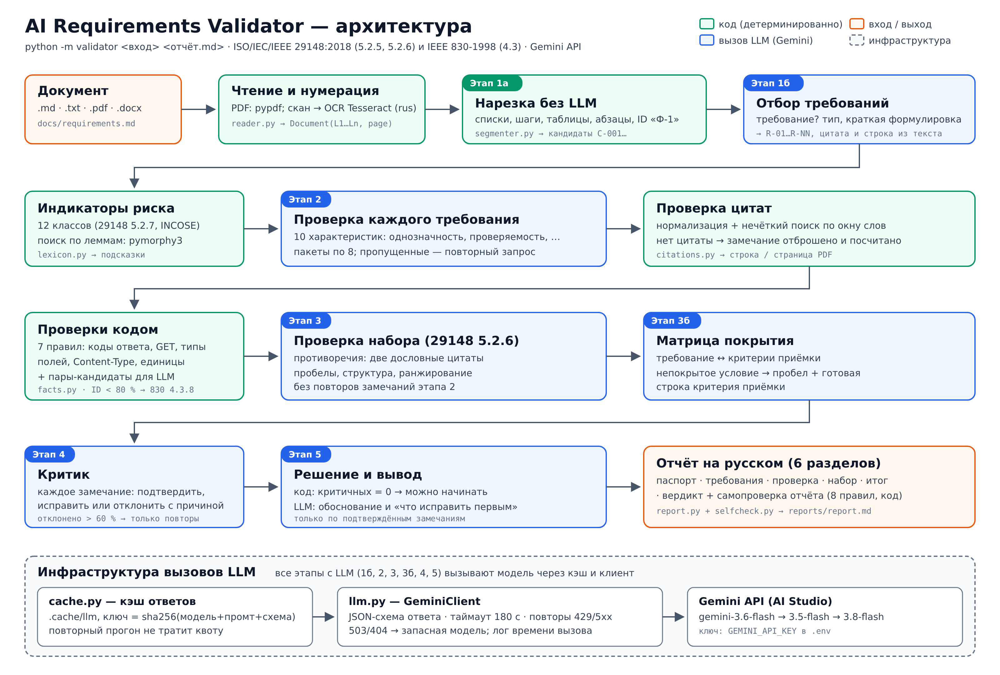

# Агент проверки требований

Агент проверяет документ с требованиями с помощью LLM Gemini и пишет отчёт на русском в формате Markdown.

Стандарты:

- ISO/IEC/IEEE 29148:2018, п. 5.2.5 (качество одного требования) и п. 5.2.6 (качество набора требований);
- IEEE 830-1998, п. 4.3 (характеристики хорошей спецификации).

## Быстрый запуск (для жюри)

Нужен Python 3.11+ и ключ Gemini API (бесплатный тариф подходит: https://aistudio.google.com/apikey).

```bash
git clone https://github.com/Da0ss/-ship.git && cd -ship
pip install -r requirements.txt
cp .env.example .env          # впишите GEMINI_API_KEY=... в .env
python -m validator docs/requirements.md reports/report.md
```

Вместо `.env` можно задать переменную окружения `GEMINI_API_KEY`: без `.env` агент берёт те же модели по умолчанию. На Windows то же самое делает `run.bat` (двойной клик).

Что получится: `reports/report.md` (отчёт), `reports/report.html` (интерактивный отчёт: документ и замечания рядом). С флагом `--json reports/report.json` — ещё и JSON; метрики по эталону — `python -m validator.evaluate reports/report.json tests/golden/requirements.golden.json`.

Что учтено для чужого ключа:

- **Модели.** Основная — `gemini-4-hydrogen`; если ключу она недоступна, перегружена или её дневная квота кончилась, агент сам переходит по цепочке `gemini-3.8-flash → gemini-3.6-flash → gemini-3.5-flash → gemini-2.5-flash`. Лёгкие этапы идут на `gemini-3.5-flash-lite`; если её нет у ключа, они выполняются на основной модели. Модели, доступные ключу: `python -m validator --list-models`.
- **Квота.** Прогон тратит около 8 запросов к основной модели и 2 к лёгкой, это укладывается в бесплатный тариф (около 20 запросов в день на модель). Время — 5–15 минут: агент выдерживает паузы, чтобы не упереться в лимит 5 запросов в минуту.
- **Другой провайдер.** OpenAI или любой OpenAI-совместимый API (OpenRouter, локальная Ollama): `LLM_PROVIDER=openai`, `OPENAI_API_KEY`, `OPENAI_MODEL`, при необходимости `OPENAI_BASE_URL` (см. `.env.example`).
- **Повторяемость.** Ответы LLM от прогона к прогону немного различаются; проверки кодом, привязка цитат к строкам и самопроверка отчёта детерминированы. Отчёт команды из финального прогона лежит в `reports/`, его паспорт показывает модель и версию агента.
- **Секреты.** Ключей в репозитории нет; `.env` и кэш ответов `.cache/` в `.gitignore`, так что прогон жюри идёт с нуля.

## Как работает



Исходник схемы: `docs/architecture.svg`.


Агент — один процесс без мультиагентного фреймворка. Этапы вызывают LLM по очереди (этап 4 идёт пакетами по 8 требований):

1. Агент читает документ (`.md`, `.txt`, `.pdf`, `.docx`) и нумерует строки. Для PDF агент хранит номер страницы.
   PDF читается с разметкой (`pdfplumber`): заголовки по размеру шрифта, таблицы с рамками — строками `| … |`, жирное начало строки («**Ф-1.**», «**200.**») сохраняется, перенесённые строки абзаца склеиваются. DOCX читается вместе с таблицами в порядке документа. Поэтому проверки кодом на PDF и DOCX находят то же, что на Markdown (тест `tests/test_formats.py`). Отключение разметки PDF: `VALIDATOR_PDF_LAYOUT=off`.
2. **Нарезка.** Код без LLM режет текст на фрагменты (`validator/segmenter.py`): пункты списков, нумерованные шаги, строки таблиц, абзацы, блоки кода. Код находит ID документа (`Ф-1`, `НФ-2`, `REQ-3.1`). LLM только отмечает, какие фрагменты — требования, и пишет краткую формулировку. Цитата и номер строки берутся из текста точно. Если ID нет, агент назначает `R-NN`.
   Запасной режим `VALIDATOR_SEGMENTER=off`: LLM режет документ сама.
3. **Проверка цитат.** Код ищет каждую цитату в тексте (без учёта Markdown-разметки, кавычек, тире, регистра; при опечатках — нечёткий поиск по окну слов). Код ставит номер строки. Замечание без найденной цитаты агент отбрасывает и считает в отчёте. Противоречие без второй цитаты агент тоже отбрасывает.
4. **Проверка каждого требования** по 29148 5.2.5 и 830 4.3. Словарь индикаторов риска (`validator/lexicon.py`, 12 классов по 29148 5.2.7 и INCOSE) ищет слова по леммам через pymorphy3: «удобным» находит «удобный», «быстрее» — сравнение без базы. Найденные слова идут в LLM как подсказки.
5. **Проверка набора** по 29148 5.2.6. Код строит пары-кандидаты на противоречие по общим понятиям (порог, месяц/дата, коды ответа, HTTP-метод, карта и др.). LLM сравнивает пары и ищет пробелы.
6. **Матрица покрытия.** Отдельный вызов LLM сопоставляет каждое функциональное и API-требование с критериями приёмки. Каждое непокрытое условие (граница диапазона, вкл/выкл, второй push, возврат) становится пробелом с цитатой и готовой строкой критерия приёмки.
   Правило прослеживаемости (IEEE 830 4.3.8) считает код: если ID документа есть меньше чем у 80 % требований, набор не проходит проверку.
6а. **Проверки кодом** (`validator/facts.py`, без LLM). 8 общих правил: код ответа используется, но не описан; идентификатор карты и суммы в строке URL; заголовок статуса с чужим названием («200 Created»); раздел статуса говорит о другом коде; GET для записи; Content-Type без тела; суммы в двух единицах без пересчёта; одно поле с разными типами в двух таблицах. Находки модели в том же месте не дублируются. Отключение: `VALIDATOR_FACTS=off`.
6б. **Банковская проверка** (`validator/review.py`). Отдельный вызов LLM проходит по чек-листу рисков карточного продукта, которых нет в ISO/IEEE: тип операции (авторизация, клиринг, отмена), валюта и курс, частичный возврат и chargeback, время и граница периода, дубли и гонки событий, сбои сервисов, состояния карты, защита данных (карта и суммы в URL и логах, PCI DSS), доступ к чужой карте, откат и feature flag, аудит, коммуникация с клиентом. Замечания помечены «🏦 банковская специфика» или «🔒 информационная безопасность» и проходят ту же проверку цитат и критика. Отключение: `VALIDATOR_DOMAIN=off`.
7. **Критик.** Отдельный вызов LLM перепроверяет каждое замечание по тексту и стандартам. Критик подтверждает замечание, исправляет его (критичность, тип, критерий) или отклоняет с причиной: цитата не показывает дефект, места совместимы, повтор. Отклонённые замечания с причинами попадают в раздел 5. Если критик отклонил больше 60 % замечаний, агент применяет только отклонение повторов (`VALIDATOR_CRITIC_MAX_REJECT`). Отключение: `VALIDATOR_CRITIC=off`.
7а. **Вопросы к бизнесу и повторы.** Если исправление требует решения владельца продукта (выбрать одно из противоречащих мест, задать значение, которого нет в документе), агент не выдумывает ответ, а пишет вопрос с 2–3 вариантами. Код дополнительно ловит правки с числами, которых нет в документе, и переводит их в вопросы. Одно противоречие, найденное с двух сторон (Ф-3↔Ф-4), объединяется в одно замечание. Цитаты, найденные нечётким поиском, заменяются точным текстом документа (опечатки модели не попадают в отчёт).
8. **Вердикт.** Код решает по правилу: есть критичное нарушение — разработку и тестирование начинать нельзя. LLM пишет обоснование и список «что исправить первым».
8а. **Чек-лист ревью банка.** Агент находит в документе чек-лист с отметками «Да / Нет» (в задании это «Ревью требований», 14 пунктов) и заполняет его: ответ, обоснование, цитата, связанные требования. Если чек-листа в документе нет, агент берёт шаблон банковского ревью. Отключение: `VALIDATOR_CHECKLIST=off`.
9. Агент пишет Markdown-отчёт: блок «Кратко» (вердикт и блокеры на одном экране), 6 обязательных разделов, раздел 7 «Чек-лист ревью требований» и раздел 8 «Вопросы к владельцу продукта». В конце раздела 6 стоит самопроверка отчёта (`validator/selfcheck.py`, 8 правил задания): разделы, паспорт, цитаты и места, нет общих утверждений, числа итога, согласие вердикта. Критерии нарушений агент приводит к единой русской форме: «ISO/IEC/IEEE 29148 5.2.5 — Однозначность», «IEEE 830 4.3.5 — Ранжирование».

Версия агента в паспорте отчёта: см. раздел «Версия агента».

## Ключ Gemini

1. Откройте Google AI Studio: https://aistudio.google.com/apikey
2. Нажмите **Create API key**. Бесплатного тарифа достаточно.
3. Скопируйте `.env.example` в `.env` и впишите ключ в `GEMINI_API_KEY`.
   Либо задайте переменную окружения: `export GEMINI_API_KEY=...`.

Ключи в репозитории не хранятся. `.env` не коммитьте.

## Установка

```bash
pip install -r requirements.txt
```

OCR для PDF-сканов (по желанию). Агент включает OCR только на страницах без текстового слоя:

Ubuntu/Debian:

```bash
sudo apt-get install -y tesseract-ocr tesseract-ocr-rus
```

macOS:

```bash
brew install tesseract tesseract-lang
```

Windows:

1. Скачайте установщик UB Mannheim: https://github.com/UB-Mannheim/tesseract/wiki
2. В установщике отметьте «Russian» в разделе Additional language data.
3. Добавьте папку установки в `PATH`, например `C:\Program Files\Tesseract-OCR`.
4. Проверьте установку командой `tesseract --list-langs`. В списке должен быть `rus`.

Режим OCR задаёт `VALIDATOR_OCR`: `auto` (по умолчанию), `off`, `force`. Язык задаёт `VALIDATOR_OCR_LANG` (по умолчанию `rus+eng`). Без Tesseract агент выводит предупреждение и читает только текстовый слой.

## Кэш ответов модели

Агент хранит ответы LLM в `.cache/llm`. Повторный прогон того же документа той же версией агента не тратит квоту. Отключение кэша: `--no-cache`. Каталог кэша задаёт `VALIDATOR_CACHE_DIR`.

Требуется Python 3.11 или новее (google-genai 3.x).

## Запуск

**Windows, проще всего:** впишите ключ в `.env` и дважды кликните `run.bat`. Скрипт создаст окружение Python (нужен Python 3.11+), поставит зависимости, проверит `docs/requirements.md` и положит отчёт в `reports/report.md`, JSON в `reports/report.json`, лог в `reports/run.log`, метрики по эталону в `reports/metrics.txt`. Другой документ: `run.bat путь\к\файлу.pdf`. Список моделей для ключа: `models.bat`.

Рядом с `report.md` агент кладёт `report.html` — интерактивный отчёт: слева документ с номерами строк (проблемные строки подсвечены цветом критичности, полоса слева показывает, где скопились дефекты), справа замечания; клик по замечанию прокручивает документ к месту, клик по строке оставляет только её замечания. Вкладки: чек-лист ревью, вопросы владельцу продукта, условия без критериев приёмки, требования. Файл самодостаточный, открывается двойным кликом. Пересобрать из сохранённого прогона: `python -m validator.html_report reports/report.json docs/requirements.md reports/report.html`.

Командная строка (любая ОС):

```bash
python -m validator docs/requirements.md reports/report.md
python -m validator docs/requirements.md reports/report.md --json reports/report.json
```

Отчёт появится по пути из второго аргумента, например `reports/report.md`. Недостающие каталоги создаются автоматически. Прогресс выводится в stderr.

Параметры:

- `--model` — модель Gemini (приоритетнее `GEMINI_MODEL`);
- `--json` — путь для JSON-версии отчёта. Используйте её в CI и для метрик;
- `--env-file` — путь к файлу с переменными окружения (по умолчанию `.env`).

Коды возврата: 0 — отчёт готов; 2 — нет входного файла или ключа; 1 — ошибка API модели (например, исчерпан лимит бесплатного тарифа). Агент повторяет запросы при ошибках 429/5xx до 6 раз.

## Версия агента

Паспорт показывает вывод `git describe --tags --long --always --dirty`, например `v0.5.0-0-g1a2b3c4`. Часть после `g` — хеш коммита. Если в клоне нет тегов, паспорт показывает только хеш. Отправляйте теги командой `git push origin --tags`.

## Проверка на втором документе

Чтобы проверить, что агент не подогнан под документ из задания, в `docs/samples/autopay.md` лежит другое учебное ТЗ (автоплатёж за коммунальные услуги) с 22 заложенными дефектами; эталон — `tests/golden/autopay.golden.json`. Документ написан после того, как правила агента были готовы, и агент под него не настраивался.

```bash
python -m validator docs/samples/autopay.md reports/autopay/report.md --json reports/autopay/report.json
python -m validator.evaluate reports/autopay/report.json tests/golden/autopay.golden.json
```

На Windows: `run_autopay.bat`.

## Выбор модели

Узнать точные идентификаторы моделей, доступных вашему ключу:

```bash
python -m validator --list-models
```

Агент делит этапы между двумя моделями, чтобы уложиться в бесплатный тариф:

- **сильная модель** (`GEMINI_MODEL`, в `.env.example` — `gemini-4-hydrogen`, запасные `gemini-3.8-flash`, `gemini-3.6-flash`) — проверка требований, проверка набора, матрица покрытия, банковская проверка, критик, чек-лист ревью. Около 8 запросов за прогон;
- **быстрая модель** (`VALIDATOR_FAST_MODEL`, в `.env.example` — `gemini-3.5-flash-lite`) — отбор фрагментов-требований и текст вердикта. Около 2 запросов за прогон. Если переменная пустая, все этапы идут на сильной модели.

На бесплатном тарифе у сильных моделей около 20 запросов в день на проект, у Flash Lite — около 500 (лимиты видны в AI Studio → Rate Limit). Когда дневная квота модели закончилась, агент сразу переключается на следующую модель из `GEMINI_FALLBACK_MODELS` (и при ответах 404/503). В паспорте отчёта стоят модели, которые реально ответили. Кэш ответов (`.cache/llm`) позволяет перезапускать прогон без расхода квоты.

## Другой провайдер LLM (OpenAI-совместимый)

Используйте его, если нет ключа Gemini или нужна другая модель. Подходит любой API Chat Completions: OpenAI, OpenRouter, локальный vLLM. Для хакатона по умолчанию остаётся Gemini.

Задайте переменные в `.env`:

- `LLM_PROVIDER=openai` — выбор провайдера (или параметр `--provider openai`).
- `OPENAI_API_KEY` — ключ (обязательно).
- `OPENAI_BASE_URL` — адрес API (по умолчанию `https://api.openai.com/v1`).
- `OPENAI_MODEL` — модель (обязательно, либо параметр `--model`).
- `OPENAI_FALLBACK_MODELS` — запасные модели через запятую.
- `LLM_MIN_INTERVAL` и `LLM_TIMEOUT` — пауза между запросами и таймаут, секунды (иначе берутся `GEMINI_MIN_INTERVAL` и `GEMINI_TIMEOUT`).

Пример для OpenRouter:

```
LLM_PROVIDER=openai
OPENAI_API_KEY=<ваш ключ>
OPENAI_BASE_URL=https://openrouter.ai/api/v1
OPENAI_MODEL=<модель из GET /v1/models>
```

Запустите как обычно: `python -m validator требования.docx отчёт.md`. Паспорт отчёта показывает модель, которая реально ответила. Если провайдер не поддерживает `response_format`, агент повторяет запрос без него.

## Качество: эталон и метрики

`tests/golden/requirements.golden.json` — 24 известных дефекта документа с номерами строк. Сравните JSON-отчёт с эталоном:

```bash
python -m validator docs/requirements.md reports/report.md --json reports/report.json
python -m validator.evaluate reports/report.json tests/golden/requirements.golden.json
```

Скрипт печатает полноту (сколько дефектов эталона найдено), полноту по критичным и оценку точности снизу (доля замечаний, которые совпали с эталоном). `--min-recall 0.7` возвращает код 1 при полноте ниже порога. Базовая линия без LLM (только проверки кодом): 25 дефектов в эталоне, полнота 44 %, точность 100 %.

## Тесты

```bash
python -m pytest -q
```

## Структура репозитория

```
validator/
  models.py     контракт данных
  reader.py     чтение документа (md, txt, pdf с OCR, docx)
  segmenter.py  нарезка на фрагменты без LLM
  lexicon.py    индикаторы неоднозначности (pymorphy3)
  citations.py  поиск цитат и номеров строк
  prompts.py    промты и JSON-схемы
  cache.py      кэш ответов LLM
  criteria.py   единая форма критериев
  selfcheck.py  самопроверка отчёта по правилам задания
  llm.py        клиент Gemini
  pipeline.py   этапы проверки
  review.py     банковская проверка, чек-лист ревью, вопросы к бизнесу, объединение повторов
  html_report.py интерактивный HTML-отчёт: документ и замечания рядом
  report.py     формирование Markdown-отчёта
  cli.py        командная строка
  __main__.py   точка входа
docs/           входной документ от организаторов (requirements.md)
reports/        отчёты, созданные агентом
tests/          тесты
```
